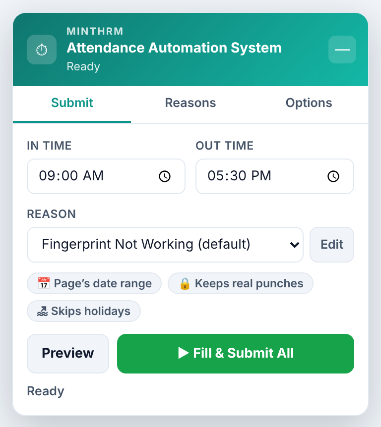
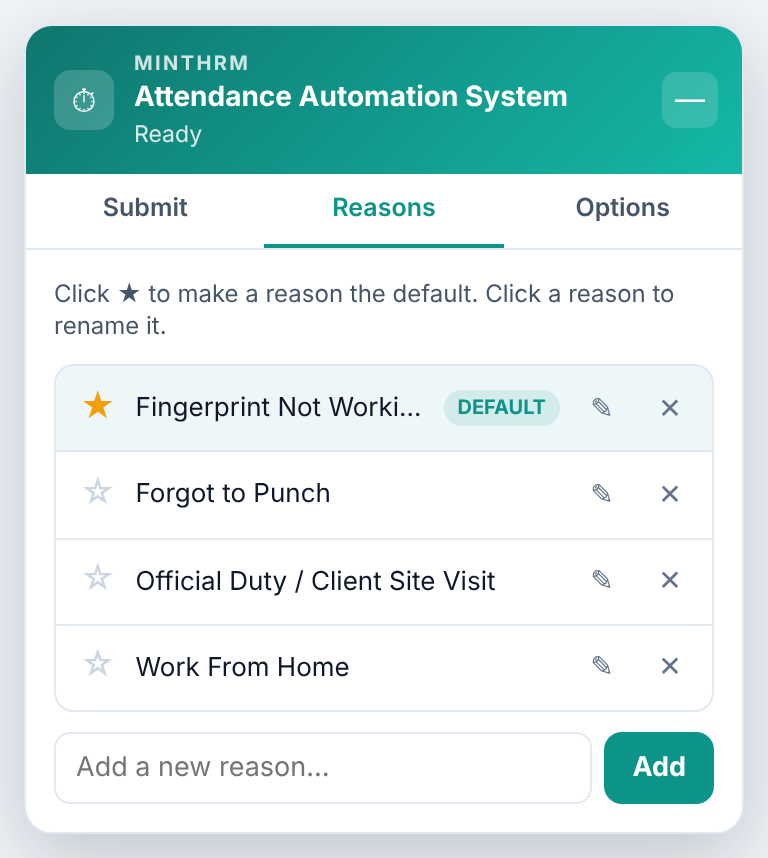
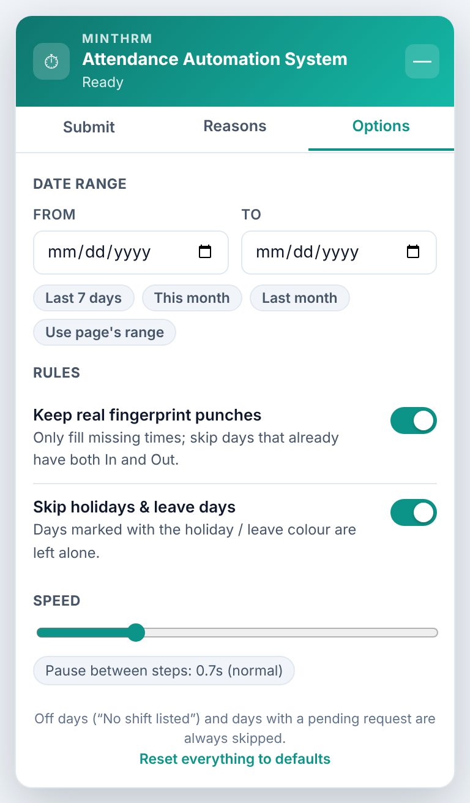
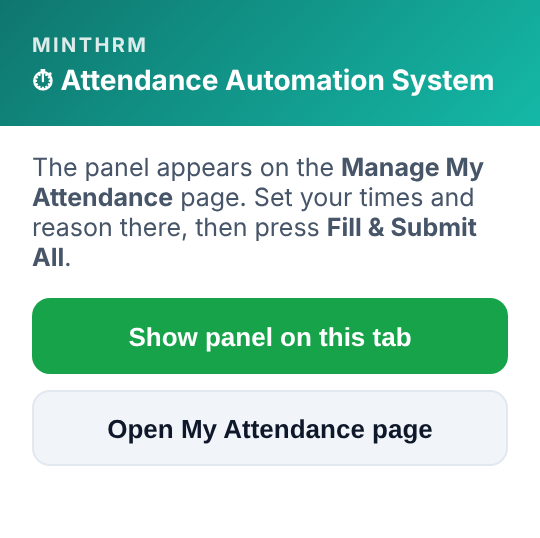

<div align="center">


# MintHRM Attendance Automation System

**Fill every missing In/Out time on MintHRM with your chosen reason, and submit them all in one click.**

[](https://github.com/AshenWijesingha/MintHRM-Attendance-Automation-System/actions/workflows/package.yml)
[](https://github.com/AshenWijesingha/MintHRM-Attendance-Automation-System/releases/latest)


### [⬇ Download the latest package (.zip)](https://github.com/AshenWijesingha/MintHRM-Attendance-Automation-System/releases/latest/download/minthrm-attendance-automation.zip)

</div>

---

## Contents

- [What it does](#what-it-does)
- [Screenshots](#screenshots)
- [Installation](#installation)
- [Updating](#updating)
- [How to use](#how-to-use)
- [Settings reference](#settings-reference)
- [Which days are skipped](#which-days-are-skipped)
- [Privacy & permissions](#privacy--permissions)
- [Troubleshooting](#troubleshooting)
- [For developers](#for-developers)
- [Releasing a new version](#releasing-a-new-version)
- [Project structure](#project-structure)
- [Changelog](#changelog)
- [Disclaimer](#disclaimer)

---

## What it does

MintHRM's **Manage My Attendance** page makes you fix each day with a missing punch by hand: type the In time, type the Out time, write a reason, click Save, confirm the popup, then move to the next day and the next page. This browser extension does all of that for you.

- **One click for the whole period.** It scans every page of your attendance list, fills each day that needs it, clicks the row's Save button, confirms the *Attendance Change Request* popup and moves on, day by day, page by page.
- **Preview first.** A dry run lists exactly which days would be submitted, without saving anything.
- **Keeps your real punches.** When a fingerprint punch exists, only the missing time is filled in.
- **Saved reasons.** Keep a list of reasons (Fingerprint Not Working, Forgot to Punch, …) and pick a default.
- **Safe by design.** Off days, holidays, leave days and days that already have a pending request are left alone.
- **Live progress.** Progress bar, Submitted / Skipped / Failed counters, a filterable log and *Copy log*.
- **Stays out of the way.** The panel lives in a Shadow DOM, so the HRM site's styles can't break it. Minimise it to a small pill and drag it anywhere.

Every entry is a normal MintHRM change request and still goes to your approver.

## Screenshots

<table>
  <tr>
    <td align="center"><br><sub><b>Submit</b></sub></td>
    <td align="center"><br><sub><b>Reasons</b></sub></td>
    <td align="center"><br><sub><b>Options</b></sub></td>
  </tr>
  <tr>
    <td align="center" colspan="3"><br><sub><b>Toolbar popup</b></sub></td>
  </tr>
</table>

## Installation

Works in **Google Chrome**, **Microsoft Edge**, **Brave** and other Chromium-based browsers.

1. **Download** [`minthrm-attendance-automation.zip`](https://github.com/AshenWijesingha/MintHRM-Attendance-Automation-System/releases/latest/download/minthrm-attendance-automation.zip) from the [latest release](https://github.com/AshenWijesingha/MintHRM-Attendance-Automation-System/releases/latest).
2. **Unzip it.** You get a folder called `minthrm-attendance-automation`.
   Move it somewhere permanent (for example `Documents`), because the browser loads the extension from that folder every time it starts.
3. **Open the extensions page:**

   | Browser | Address |
   |---|---|
   | Chrome | `chrome://extensions` |
   | Edge | `edge://extensions` |
   | Brave | `brave://extensions` |

4. Turn on **Developer mode** (top-right in Chrome and Brave, left sidebar in Edge).
5. Click **Load unpacked** and select the `minthrm-attendance-automation` folder (the one that contains `manifest.json`).
6. *Optional:* click the puzzle-piece icon in the toolbar and **pin** the extension.

> [!NOTE]
> If you used the older **Attendance Auto-Fill** extension, remove it first. Settings and reasons start fresh in this version.

> [!TIP]
> Want to check the download? Each release also has a `SHA256SUMS.txt` file.
> On Windows run `certutil -hashfile minthrm-attendance-automation.zip SHA256`; on macOS or Linux run `shasum -a 256 minthrm-attendance-automation.zip`, and compare the result.

## Updating

1. Download the new zip from the [latest release](https://github.com/AshenWijesingha/MintHRM-Attendance-Automation-System/releases/latest).
2. Unzip it **over the same folder** you installed from, replacing the files.
3. On the extensions page, click the **↻ reload** icon on the extension's card.

Your reasons and settings are kept, because they live in the browser's extension storage, not in the folder.

## How to use

1. Sign in to MintHRM and open **Self → Manage My Attendance**.
   (Or click the extension icon and choose **Open My Attendance page**.)
2. The **Attendance Automation System** panel appears in the bottom-right corner.
   If you minimised it, click the pill, or use **Show panel on this tab** in the toolbar popup.
3. On the **Submit** tab, check the **In** and **Out** times and choose a **Reason**.
4. Click **Preview**. The log lists every day that *would* be submitted, and why the others are skipped. Nothing is saved.
5. When the list looks right, click **▶ Fill & Submit All**.
6. Watch the progress bar and counters. Click **Stop** at any time; it halts after the current step.
7. When it finishes, click a counter (Submitted / Skipped / Failed) to filter the log, or **Copy log** to keep a record.

The chips under the reason (📅 date range, 🔒 punches, 🏖 holidays) summarise your current options. Click one to jump to the **Options** tab.

## Settings reference

All settings are saved automatically and remembered between visits.

### Submit tab

| Setting | Default | What it does |
|---|---|---|
| **In time** | `09:00` | Time used when the In punch is missing. |
| **Out time** | `17:30` | Time used when the Out punch is missing. |
| **Reason** | your default reason | Text sent with every change request in this run. **Edit** jumps to the Reasons tab. |

### Reasons tab

| Action | How |
|---|---|
| Add a reason | Type it in the box and click **Add** (or press Enter). Duplicates are rejected. |
| Make it the default | Click the **☆** star. The default is pre-selected on the Submit tab. |
| Rename | Click the reason text or **✎**, edit, then **✓** (or Enter) to save, **↺** (or Esc) to cancel. |
| Delete | Click **✕**. At least one reason must remain. |

Built-in reasons: *Fingerprint Not Working* (default), *Forgot to Punch*, *Official Duty / Client Site Visit*, *Work From Home*.

### Options tab

| Setting | Default | What it does |
|---|---|---|
| **Date range** (From / To) | page's range | Sets MintHRM's own date filter to these dates before scanning. Quick picks: *Last 7 days*, *This month*, *Last month*, *Use page's range* (clears the custom range). |
| **Keep real fingerprint punches** | On | Only fill missing times; days that already have both In and Out are skipped. Turn off to overwrite both times. |
| **Skip holidays & leave days** | On | Days marked with MintHRM's holiday / leave colour are left alone. |
| **Speed** | 0.7 s | Pause between steps. Use a slower (*careful*) setting if MintHRM is slow or you see failures. |
| **Reset everything to defaults** | – | Restores times, reasons, rules and speed to the defaults above. |

## Which days are skipped

| Day | Skipped | Can be changed |
|---|---|---|
| Off days (“No shift listed”) | Always | No |
| Days with a change request already pending | Always | No |
| Holidays and leave days | By default | Options → *Skip holidays & leave days* |
| Days with both real punches | By default | Options → *Keep real fingerprint punches* |
| Days outside the date range | Always (the page's date filter is set to your range before scanning) | Options → *Date range* |

## Privacy & permissions

- **Runs only on MintHRM.** The script is injected only on `https://*.minthrm.com/…/dailyattendance/MyAttendance` pages.
- **One permission: `storage`.** Used to remember your times, reasons and options in your own browser.
- **No data leaves your browser.** There are no analytics, no tracking and no external servers. The extension only clicks the same buttons you would click on MintHRM.

## Troubleshooting

<details>
<summary><b>The panel doesn't appear</b></summary>

- Make sure you are on **Self → Manage My Attendance** (the address contains `dailyattendance/MyAttendance`).
- Check the extension is **enabled** on the extensions page.
- Reload the page (F5). If you just installed or updated the extension, the page must be reloaded once.
- If you minimised the panel, look for the small pill, or use **Show panel on this tab** in the toolbar popup.
</details>

<details>
<summary><b>“Open the My Attendance page first.” in the popup</b></summary>

The current tab isn't the MintHRM attendance page, or it was opened before the extension was installed. Open the page (or reload it) and try again.
</details>

<details>
<summary><b>“Open My Attendance page” goes to the wrong company</b></summary>

The popup button opens `limra.minthrm.com`. If your company uses another MintHRM subdomain, open your own attendance page directly; the panel works on every `*.minthrm.com` domain.
</details>

<details>
<summary><b>Some days show as Failed</b></summary>

- Open **Options → Speed** and move the slider towards *careful*, then run again. Days already submitted are now pending and will be skipped.
- Use **Copy log** to see the reason for each failure.
</details>

<details>
<summary><b>A day I expected wasn't submitted</b></summary>

Run **Preview** and click the **Skipped** counter. Each skipped day shows why (off day, holiday / leave, request already pending, already has In & Out). If the day isn't listed at all, check **Options → Date range**.
</details>

<details>
<summary><b>“Load unpacked” says the manifest file is missing</b></summary>

You selected the wrong folder. Select the folder that directly contains `manifest.json` (named `minthrm-attendance-automation`), not the folder above it or the zip file.
</details>

<details>
<summary><b>Chrome warns about developer-mode extensions</b></summary>

This is normal for extensions installed with *Load unpacked*. Click the close button on the warning; the extension keeps working.
</details>

## For developers

**Requirements:** Node.js 18+ and `zip` (preinstalled on macOS and most Linux distributions; on Windows use Git Bash or WSL).

```bash
git clone https://github.com/AshenWijesingha/MintHRM-Attendance-Automation-System.git
```

```bash
cd MintHRM-Attendance-Automation-System
```

**Run the extension from source:** load the repository folder itself with *Load unpacked*. After editing a file, click ↻ on the extension card and reload the MintHRM page.

**Validate** the manifest, referenced files, icon sizes and JavaScript syntax:

```bash
node scripts/validate.mjs
```

**Build the downloadable package:**

```bash
./scripts/build.sh
```

This validates first, then writes to `dist/`:

| File | Purpose |
|---|---|
| `minthrm-attendance-automation-v<version>.zip` | Versioned package |
| `minthrm-attendance-automation.zip` | Same file with a stable name, used by the “latest” download link |
| `SHA256SUMS.txt` | Checksums for both |

The zip contains a single `minthrm-attendance-automation/` folder with only the files the extension needs. It can be installed with *Load unpacked* or uploaded unchanged to the Chrome Web Store / Edge Add-ons dashboards. Builds are reproducible: the same sources always give the same zip.

**Continuous integration:** every push and pull request runs the same validation and build in GitHub Actions. The package is attached to each run under **Artifacts**.

## Releasing a new version

1. Bump `"version"` in [`manifest.json`](manifest.json) (for example `2.1.0` → `2.2.0`).
2. Add a `## [2.2.0] - YYYY-MM-DD` section to [`CHANGELOG.md`](CHANGELOG.md). It becomes the release notes.
3. Commit and merge to `main`.
4. Publish, either way:
   - **From GitHub:** *Actions → Build & Release Package → Run workflow* (leave *publish* ticked), or
   - **From the command line:** push a tag that matches the manifest version:

     ```bash
     git tag v2.2.0
     ```

     ```bash
     git push origin v2.2.0
     ```

The workflow validates, builds and creates the GitHub Release with the zip and checksums attached. A tag that doesn't match `manifest.json` fails the build, so a release can never ship the wrong version.

## Project structure

```text
.
├── manifest.json            Extension manifest (MV3): name, version, permissions, content script match
├── content.js               The panel UI and the automation (scan → fill → save → confirm → next page)
├── popup.html / popup.js    Toolbar popup: “Show panel on this tab” and “Open My Attendance page”
├── icons/                   16, 48 and 128 px icons
├── README.txt               Quick-start guide shipped inside the zip
├── scripts/
│   ├── validate.mjs         Pre-package checks
│   └── build.sh             Builds dist/*.zip and checksums
├── docs/screenshots/        Images used in this README
├── .github/workflows/
│   └── package.yml          CI build + GitHub Release publishing
└── CHANGELOG.md
```

## Changelog

See [CHANGELOG.md](CHANGELOG.md) for the full history.

## Disclaimer

This is an independent tool and is not affiliated with or endorsed by MintHRM. It submits ordinary attendance change requests on your behalf, using your own signed-in session. You are responsible for the times and reasons you submit, so always **Preview** first and follow your organisation's attendance policy.
